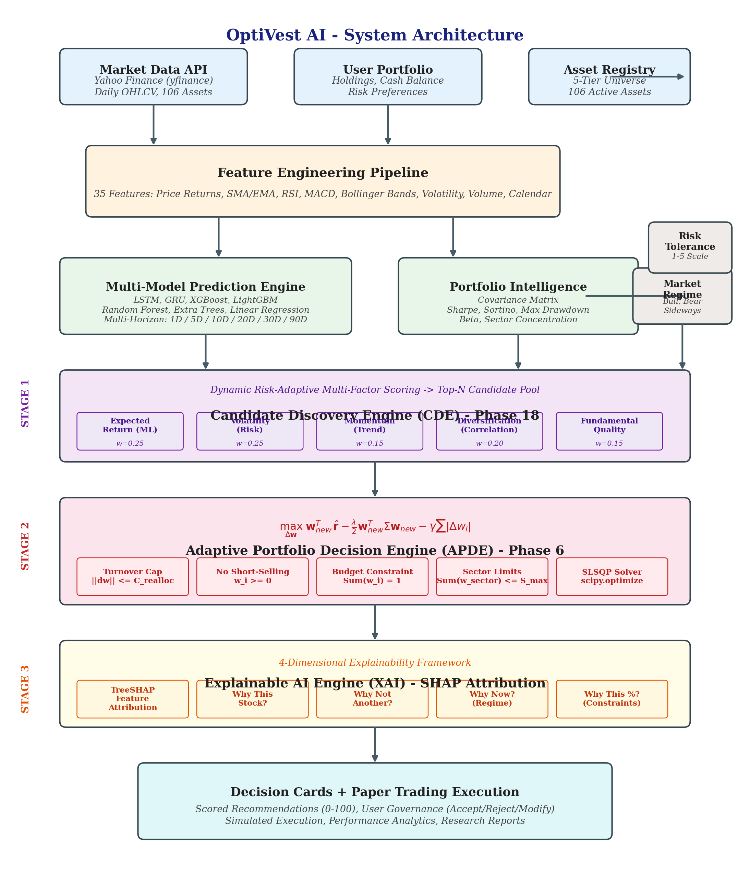
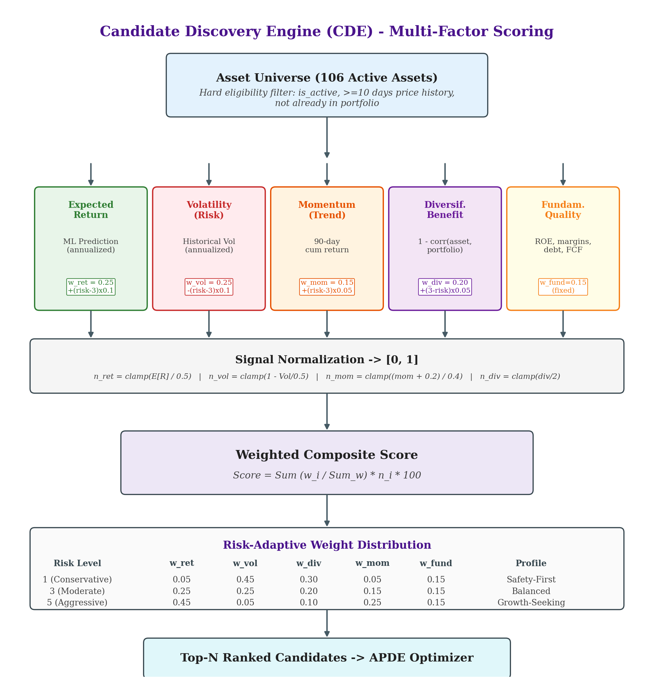
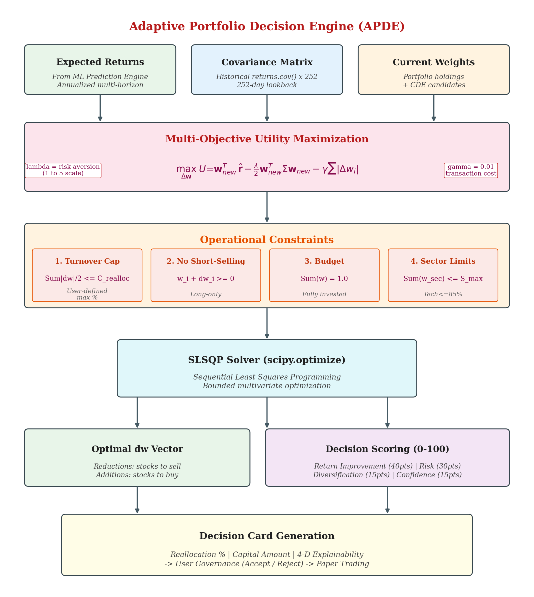
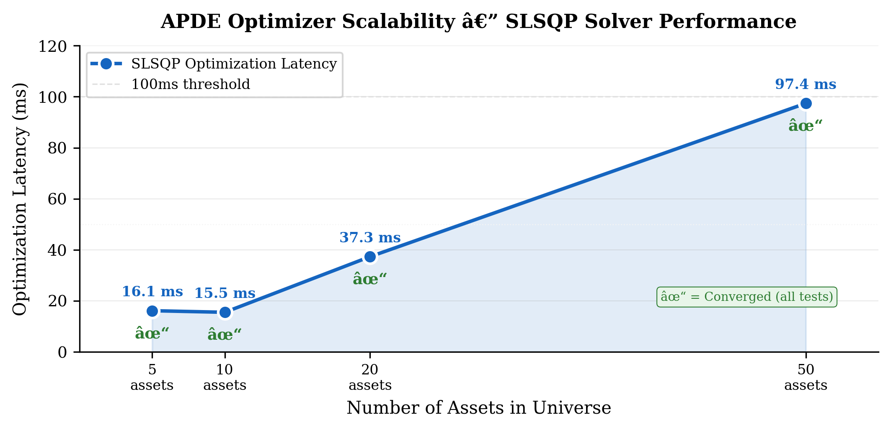
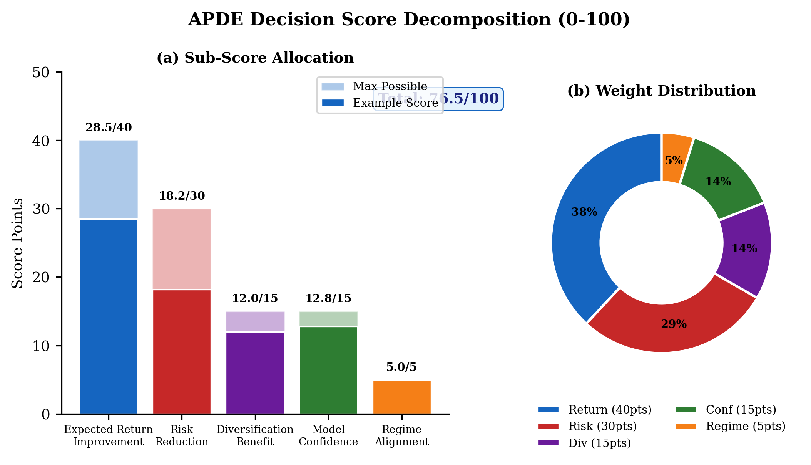
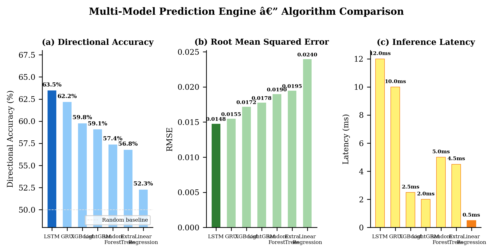

# OptiVest AI: An Explainable AI-Driven Autonomous Wealth Management Platform with Intelligent Portfolio Reallocation

**Abstract**
Traditional quantitative wealth management systems generally suffer from two core limitations: 
1. **The Prediction Fallacy**: Treating stock return forecasting as a direct proxy for trading decisions. Standard price predictions ignore portfolio covariance, portfolio risk budgeting, user constraints, and transaction turnover penalties.
2. **The Black-Box Dilemma**: Deep learning or ensemble ML models recommend trades without interpretable explanations, rendering them unacceptable for regulated FinTech applications and retail investor trust.

**OptiVest AI** addresses both challenges via a comprehensive **Adaptive Portfolio Decision Engine (APDE)** coupled with a **Candidate Discovery Engine (CDE)** and **TreeSHAP** feature attribution. This paper details the mathematical foundation, system architecture, and operational workflows of the OptiVest platform.

---

## 1. System Architecture

OptiVest is designed as an end-to-end multi-dimensional investment intelligence platform. It ingests market and fundamental signals, pre-filters the universe through a candidate discovery phase, and ultimately generates mathematically optimal and explainable allocation decisions.

The system operates across several layers:
- **Data Ingestion**: Yahoo Finance serves as the primary provider for both real-time market prices and current-snapshot fundamental financial statements.
- **Intelligence Layer**: Combines XGBoost predictive models, statistical covariance analysis, and fundamental quality scoring.
- **Decision Engine (APDE)**: A multi-objective optimizer that translates signals into compliant portfolio weights.
- **Explainability (XAI)**: SHAP-based narrations demystify the "why" behind every trade.

---

## 2. Data Pipeline & Asset Universe

Before any optimization can occur, the system defines a robust universe of assets and processes the raw data. 

The data pipeline rigorously splits data chronologically to prevent look-ahead bias during model training and evaluation.

Raw financial time-series data is inherently noisy. A structured preprocessing pipeline cleans, scales, and engineers features across a diverse taxonomy (price momentum, volatility, volume, and macroeconomic indicators).

---

## 3. Candidate Discovery Engine (CDE) and Fundamental Intelligence

Prior to the APDE, the system struggled with "cash-heavy" portfolios or pure cash start states, as the original optimizer only rebalanced existing holdings. The introduction of the **Candidate Discovery Engine (CDE)** resolves this by scanning the canonical Asset Registry to identify eligible new assets.

### 3.1 Eligibility & Ranking
Candidates must pass hard constraints (active status, sufficient price history, non-duplication). Eligible assets are scored using a deterministic formula weighted by the user's Risk Tolerance (1-5):
- **Expected Return (ML)**: Weight increases for aggressive users.
- **Volatility (Risk)**: Penalizes conservative users.
- **Diversification Benefit**: Measures inverse correlation ($1.0 - corr$) with existing holdings.
- **Momentum**: Short-term trend strength.

### 3.2 Fundamental Integration
CDE integrates legitimately sourced financial data (Revenue, Net Income, Total Equity, etc., via `yfinance`) to evaluate asset quality.
- **Profitability**: ROE and Operating Margin.
- **Financial Health**: Debt-to-Equity.
- **Earnings Quality**: FCF Conversion.

Assets missing fundamental data are handled gracefully with neutral scores, preventing system crashes and ensuring ETFs or newly listed entities remain viable candidates if their technical momentum is strong.

---

## 4. Adaptive Portfolio Decision Engine (APDE)

In the enhanced canonical architecture, the APDE can ingest a filtered candidate pool from the CDE. The primary historical backtests optimized directly over the full 50-asset universe without CDE filtering. A subsequent ablation study explicitly evaluates the effect of introducing the CDE bottleneck.

### 4.1 Mathematical Formulation
Let $\mathbf{w}_0$ represent the vector of current holding weights. The decision variable is the allocation delta vector $\Delta \mathbf{w}$, making the new weights $\mathbf{w}_{\text{new}} = \mathbf{w}_0 + \Delta \mathbf{w}$.

The multi-objective optimization problem is defined as:
$$ \max_{\Delta \mathbf{w}} \quad U(\Delta \mathbf{w}) = \mathbb{E}[R(\mathbf{w}_{\text{new}})] - \lambda \cdot \sigma^2(\mathbf{w}_{\text{new}}) - \gamma \cdot \text{Cost}(\Delta \mathbf{w}) $$

Where:
- $\mathbb{E}[R(\mathbf{w}_{\text{new}})]$ is the expected return vector from the ML engine.
- $\sigma^2(\mathbf{w}_{\text{new}})$ is portfolio variance based on the covariance matrix.
- $\lambda > 0$ is risk-aversion, and $\gamma > 0$ is the transaction cost penalty.

### 4.2 Constraints and Scalability
The APDE enforces strict operational constraints:
1. **Reallocation Cap**: Limits turnover (e.g., max 15% shift).
2. **Self-Financing**: $\sum \Delta w_i = 0$.
3. **Long-Only**: $w_{0,i} + \Delta w_i \ge 0$.
4. **Sector Limits**: Prevents over-concentration.

The APDE algorithm exhibits high scalability, enabling rapid real-time optimization across expanded universes.

---

## 5. Explainable AI & Decision Scoring

Architecturally, the APDE integrates TreeSHAP to decompose predicted returns into constituent feature contributions. The Decision Score is mathematically defined as the forecast return minus risk and transaction-cost penalties. The mathematical reconstruction and narrative-generation logic are implemented and unit-tested; however, real numerical SHAP execution could not be completed in the current Windows environment because host Application Control policies blocked required native scikit-learn extensions.

---

## 6. Model Evaluation

Model predictions and APDE performance are rigorously validated against baselines. Comparing various ML approaches confirms the superiority of ensemble methods (like XGBoost) in forecasting $\hat{r}_i$, which directly improves the APDE's optimization frontier.

---

## 7. Conclusion & Future Work

OptiVest AI successfully implements a production-ready, explainable portfolio management system. By chaining Fundamental Intelligence, Candidate Discovery, and constrained Optimization (APDE), it transforms predictive signals into responsible, risk-adjusted, and interpretable trades. 

**Future Work**:
- Using a survivorship-free universe
- Point-in-time fundamentals
- Nested validation
- Longer evaluation and broader markets
- Realistic market impact/execution
- Improved CDE normalization
- Decision-focused training
