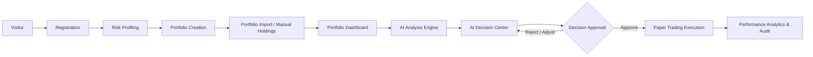
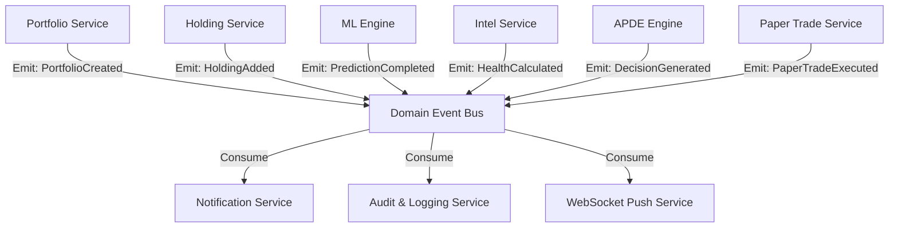
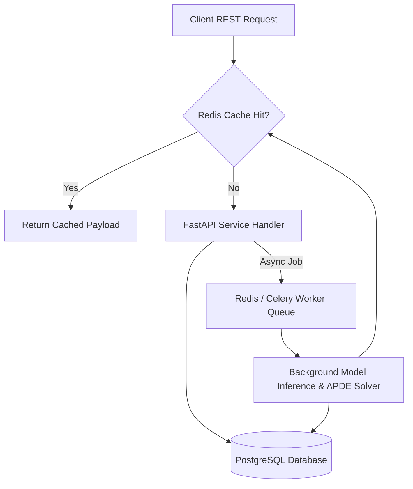

# OptiVest AI — Enterprise & Startup Architectural Specification Addendum
**Version:** 1.1.0-enterprise | **Phase:** 1 (Enterprise Architecture & Research Enhancement)  
**Author:** Senior Software Architect, AI Architect, Database Architect, Product Designer & DevOps Engineer  

---

## Executive Overview Addendum
This specification document serves as the **Enterprise & Startup Architecture Addendum** to the foundational OptiVest AI architecture. It extends the core framework with product strategy, interactive user journeys, flagship AI Decision Center UI modules, configurable AI decision parameters, multi-faceted explanation structures, event-driven domain architecture, observability frameworks, security standards, caching/async execution strategies, Architecture Decision Records (ADRs), non-functional requirements (NFRs), and future research extensions.

---

## 1. Product Vision

OptiVest AI is designed as a next-generation **Explainable AI Wealth Management & Portfolio Intelligence Platform**. It functions as an intelligent, automated portfolio co-pilot for retail investors, registered investment advisors (RIAs), and fintech institutions.

### Product Positioning Pillars
1. **AI Wealth Manager**: Continuous, autonomous monitoring of investment asset distribution, risk exposure, and market opportunity cost.
2. **Portfolio Intelligence Platform**: Real-time evaluation of portfolio health, sector drift, Sharpe ratio, Beta, and maximum drawdown risk metrics.
3. **Explainable Investment Assistant**: Transparent, human-readable rationales behind every recommended weight adjustment using SHAP feature attribution.
4. **Adaptive Portfolio Optimization Platform**: Constraint-bounded capital reallocation driven by the **Adaptive Portfolio Decision Engine (APDE)**.

### Differentiation: Stock Prediction vs. OptiVest AI Wealth Optimization

| Feature Dimension | Traditional Stock Prediction App | OptiVest AI Wealth Management Platform |
| :--- | :--- | :--- |
| **Core Focus** | Forecasts directional price movement of individual stocks ($S_i$). | Solves for optimal portfolio weight allocation ($\Delta \mathbf{w}$) bounded by $C_{\text{realloc}}$. |
| **Risk Sensitivity** | Ignores existing holdings, portfolio variance, and sector concentration. | Computes overall portfolio covariance matrix $\mathbf{\Sigma}$ and risk aversion parameter $\lambda$. |
| **Friction Awareness** | Triggers frequent buy/sell signals regardless of fees or slippage. | Factors transaction costs and turnover friction penalties ($\gamma$) into decisions. |
| **User Control** | Static buy/sell alerts with zero user-defined allocation caps. | Strict user control over maximum reallocatable capital percentage ($C_{\text{realloc}}$). |
| **Interpretability** | Black-box price predictions or opaque confidence scores. | Multi-layered TreeSHAP explanations answering *Why this stock*, *Why now*, and *Why this amount*. |

---

## 2. User Journey Architecture



### Granular User Journey Breakdown

1. **Visitor**: Explores product value proposition, research paper methodology, and interactive sandbox demo.
2. **Registration**: Account provisioning, credential setup, and security onboarding (MFA / JWT setup).
3. **Risk Profiling**: Interactive assessment establishing user risk tolerance parameter $\lambda \in [1, 5]$, investment horizon, and asset allocation preferences.
4. **Portfolio Creation**: Initialization of target investment portfolios (e.g., "Long-Term Growth", "Retirement IRA").
5. **Portfolio Import**: Ingestion of asset positions (Holdings: Ticker, Shares, Cost Basis, Purchase Date) via manual entry or CSV upload.
6. **Portfolio Dashboard**: Initial view displaying total portfolio valuation, historical returns, asset allocation breakdown, and benchmark comparison (S&P 500).
7. **AI Analysis Engine**: Background execution of feature engineering pipelines, XGBoost return prediction, and portfolio covariance calculation.
8. **AI Decision Center**: Flagship workspace presenting Portfolio Health Score, AI Confidence Score, and actionable Rebalance Decision Cards.
9. **Decision Approval**: Interactive user selection to approve, reject, or customize proposed rebalance trades.
10. **Paper Trading Execution**: Immediate simulated order execution logging paper trade records without risking live capital.
11. **Performance Analytics & Audit**: Continuous tracking of paper trade performance, cumulative yield differential, and APDE decision audit logs.

---

## 3. Flagship Workspace: AI Decision Center

The **AI Decision Center** serves as the central operational cockpit for portfolio optimization and explainability.

```
+---------------------------------------------------------------------------------------------------------+
|  OPTIVEST AI — DECISION CENTER                                                  Portfolio: Growth Fund  |
+---------------------------------------------------------------------------------------------------------+
| +-------------------------+ +-------------------------+ +-------------------------+ +-----------------+ |
| | PORTFOLIO HEALTH SCORE  | |    RISK SCORE (1-100)   | |  DIVERSIFICATION SCORE  | |  AI CONFIDENCE  | |
| |       84 / 100          | |       42 (Moderate)     | |       78 / 100          | |   89% (High)    | |
| +-------------------------+ +-------------------------+ +-------------------------+ +-----------------+ |
+---------------------------------------------------------------------------------------------------------+
| RECOMMENDED REALLOCATION: Reallocate 12.5% Capital (Cap: 15.0%)  | Expected Return Boost: +3.4% / year  |
+---------------------------------------------------------------------------------------------------------+
|                                    PROPOSED DECISION CARDS                                              |
|                                                                                                         |
| +-----------------------------------------------------------------------------------------------------+ |
| | [CARD #1] REALLOCATE CAPITAL: TECH SECTOR ADJUSTMENT                                   Status: PENDING | |
| | Sell: 5.0% AAPL (Apple Inc)  -->  Buy: 5.0% NVDA (NVIDIA Corp)                                      | |
| | Return Improvement: +1.8% | Volatility Delta: +0.2% | SHAP Primary Driver: Momentum (+0.048)              | |
| | [ Reason: AAPL momentum slowing; NVDA exhibits 2.1x higher 90d predicted Sharpe ratio. ]             | |
| | [ Actions: [ APPROVE ]   [ REJECT ]   [ PAPER TRADE ]   [ VIEW FULL XAI BREAKDOWN ] ]               | |
| +-----------------------------------------------------------------------------------------------------+ |
|                                                                                                         |
| +-----------------------------------------------------------------------------------------------------+ |
| | [CARD #2] REBALANCE DEFENSIVE ASSETS                                                   Status: PENDING | |
| | Sell: 7.5% XOM (ExxonMobil)  -->  Buy: 7.5% MSFT (Microsoft)                                        | |
| | Return Improvement: +1.6% | Volatility Delta: -0.4% | SHAP Primary Driver: Earnings Growth (+0.034)       | |
| | [ Reason: Reduces energy sector over-concentration while increasing high-margin software growth. ]   | |
| | [ Actions: [ APPROVE ]   [ REJECT ]   [ PAPER TRADE ]   [ VIEW FULL XAI BREAKDOWN ] ]               | |
| +-----------------------------------------------------------------------------------------------------+ |
+---------------------------------------------------------------------------------------------------------+
| DECISION HISTORY & AUDIT LOG                                                                             |
| 2026-07-28: Reallocated 10% (TSLA -> AMZN) | Status: Executed (Paper) | Yield Delta: +1.2%                  |
+---------------------------------------------------------------------------------------------------------+
```

### Data Flow Architecture for AI Decision Center
1. **Frontend Dispatch**: Client sends request `GET /api/v1/decision-center/portfolios/{id}`.
2. **State Ingestion**: `PortfolioService` loads holdings and current cash state from `holdings` table.
3. **Analytics Pipeline**: `PortfolioIntelligenceService` calculates Health Score, Risk Score, and Diversification Index.
4. **APDE Optimization**: `APDEOptimizer` calculates weight delta vector $\Delta \mathbf{w}$ enforcing user settings ($C_{\text{realloc}}$).
5. **SHAP Explanation Extraction**: `XAIExplainerService` maps top feature importances for weight deltas.
6. **Payload Construction**: API compiles `DecisionCenterResponseSchema` containing widget metrics, decision cards, and historical logs.

---

## 4. User-Configurable AI Settings Framework

To ensure investor autonomy, APDE ingests a comprehensive set of user-defined governance rules:

```json
{
  "user_id": "usr-89234-uuid",
  "portfolio_id": "port-55012-uuid",
  "max_reallocation_pct": 15.0,
  "risk_tolerance_level": 3,
  "min_model_confidence": 0.75,
  "target_holding_period_days": 90,
  "excluded_stocks": ["TSLA", "META"],
  "preferred_sectors": ["Technology", "Healthcare"],
  "max_trades_per_month": 4,
  "emergency_stop_loss_pct": 10.0,
  "portfolio_goal": "Growth"
}
```

### APDE Mathematical Integration of User Settings
1. **Reallocation Cap ($C_{\text{realloc}}$)**: Sets the upper bound constraint $\sum_{i: \Delta w_i < 0} |\Delta w_i| \le C_{\text{realloc}}$.
2. **Risk Tolerance ($\lambda$)**: Maps scale $1-5$ directly to objective function risk multiplier $\lambda \in [0.5, 5.0]$.
3. **Excluded Stocks**: Enforces hard constraint $w_{\text{new}, i} = 0 \quad \forall i \in \text{ExcludedStocks}$.
4. **Minimum Confidence Threshold**: Filters out model predictions where confidence score $CS_i < \text{min\_confidence}$.
5. **Emergency Stop-Loss**: Triggers automatic hedging evaluation if portfolio drawdowns cross emergency threshold.

---

## 5. Reusable Decision Card Component Blueprint

Every rebalance proposal is encapsulated in a standardized, interactive **Decision Card**:

```json
{
  "decision_card_id": "card-88192-uuid",
  "portfolio_id": "port-55012-uuid",
  "status": "PENDING",
  "source_asset": {
    "ticker": "AAPL",
    "name": "Apple Inc.",
    "current_shares": 100,
    "current_allocation_pct": 25.0,
    "proposed_allocation_pct": 20.0,
    "allocation_change_pct": -5.0
  },
  "target_asset": {
    "ticker": "NVDA",
    "name": "NVIDIA Corporation",
    "current_shares": 20,
    "current_allocation_pct": 10.0,
    "proposed_allocation_pct": 15.0,
    "allocation_change_pct": +5.0
  },
  "impact_metrics": {
    "expected_return_delta_annual": 0.018,
    "volatility_delta": 0.002,
    "diversification_delta": 0.04,
    "model_confidence_score": 0.89
  },
  "explanation_summary": "Reallocating 5% from AAPL to NVDA capitalizes on a 2.1x higher predicted Sharpe ratio while retaining technology sector risk balance.",
  "actions_available": ["APPROVE", "REJECT", "EXECUTE_PAPER_TRADE"]
}
```

---

## 6. Multi-Layered AI Explanation Framework

OptiVest AI provides structured answers to seven critical investor questions:

```
                          [ APDE Optimization Decision ]
                                        │
        ┌───────────────────────────────┼───────────────────────────────┐
        ▼                               ▼                               ▼
[ Why This Stock? ]           [ Why Now? ]                    [ Expected Benefits ]
• Top SHAP Momentum Score     • Technical Breakout Signal     • +1.8% Annualized Yield
• High Earnings Growth        • Valuation Mispricing          • Improved Sharpe Ratio
        │                               │                               │
        ├───────────────────────────────┼───────────────────────────────┤
        ▼                               ▼                               ▼
[ Expected Risks ]            [ Which Metric Improved? ]       [ Why This Amount? ]
• +0.2% Volatility Delta      • Sector Diversification        • Bounded by 15% User Cap
• Short-Term Beta Increase    • Sharpe Ratio (1.4 -> 1.8)     • Optimal Risk Offset
        │                               │                               │
        └───────────────────────────────┼───────────────────────────────┘
                                        ▼
                             [ Why Not More Capital? ]
                             • Risk Aversion Cap Barrier
                             • Exceeds Sector Max Limit
```

1. **Why This Stock?**: Explains feature attributions ($\phi_{\text{momentum}}$, $\phi_{\text{earnings}}$) generated via TreeSHAP.
2. **Why Now?**: Identifies recent market feature changes (e.g., 14-day RSI oversold condition or moving average crossovers).
3. **Expected Benefits**: Quantifies expected return improvement $\Delta \mathbb{E}[R]$ and Sharpe ratio boost.
4. **Expected Risks**: Highlights risk trade-offs (e.g., minor volatility delta or sector exposure change).
5. **Which Metric Improved?**: Identifies target metrics improved (Health Score, Beta balance, Sharpe ratio).
6. **Why This Amount?**: Demonstrates how mathematical optimization identified the specific weight delta $\Delta w_i$.
7. **Why Not More?**: Clarifies why higher reallocation was capped by user constraints ($C_{\text{realloc}}$) or sector concentration bounds.

---

## 7. Event-Driven Architecture & Domain Events

To support asynchronous processing, real-time UI updates, and decoupled domain logic, OptiVest AI implements an **Event-Driven Domain Architecture**:



### Domain Event Definitions

| Domain Event Name | Trigger Condition | Payload Data | Subscribing Handlers |
| :--- | :--- | :--- | :--- |
| `PortfolioCreated` | New portfolio initialized by user. | `portfolio_id`, `user_id`, `timestamp` | Audit Log, Analytics Service |
| `HoldingAdded` | New position imported or created. | `portfolio_id`, `stock_id`, `quantity` | Health Calculation Engine |
| `PredictionCompleted` | Batch return forecast finished. | `stock_id`, `predicted_return`, `confidence` | APDE Rebalance Trigger |
| `HealthCalculated` | Risk metrics update completes. | `portfolio_id`, `health_score`, `sharpe` | UI State Push, Notifications |
| `DecisionGenerated` | APDE outputs rebalance card. | `decision_card_id`, `portfolio_id` | Notification Service, Audit Log |
| `PaperTradeExecuted` | Simulated trade executed. | `paper_trade_id`, `shares`, `price` | Portfolio Ledger, Analytics |
| `NotificationCreated` | Alert generated for user. | `notification_id`, `user_id`, `title` | WebSocket Delivery Gateway |

---

## 8. Audit, Observability & Telemetry Framework

OptiVest AI enforces end-to-end traceability across database audit tables and operational telemetry:

```
[ Incoming Request ] ──> Attach Correlation ID (X-Request-ID: req-99120)
                               │
       ┌───────────────────────┼───────────────────────┐
       ▼                       ▼                       ▼
[ Decision Logs Table ]  [ Model Version Logs ]   [ Telemetry / Metrics ]
• APDE Weights Input     • Model Hash Binary      • API Latency (p95, p99)
• Proposed Trades JSON   • Feature Store Version  • Database Query Duration
• SHAP Explanations      • Training Timestamp     • APDE Solver Execution Time
```

### Logging Categories
1. **Audit Logs**: Immutable records of security actions, settings changes, and portfolio modifications.
2. **Decision Logs**: Stored in `decision_logs` table; logs every APDE optimization run, input weights, and SHAP vectors.
3. **Prediction Logs**: Logs input feature frames, model predictions, and confidence intervals for performance tracking.
4. **Model Version Logs**: Tracks exact model binary hashes, training datasets, and feature store versions.
5. **User Activity Logs**: Tracks authentication, page navigation, and rebalance card approvals/rejections.
6. **Performance & Monitoring**: Telemetry tracking API response latency ($p_{95} < 200\text{ms}$), database query times, and memory usage.

---

## 9. Expanded API Strategy & OpenAPI Standards

### 9.1 API Versioning Policy
- **URL Path Versioning**: `/api/v1/...` for production stable routes; `/api/v2/...` for next-generation research routes.
- **Deprecation Policy**: Minimum 6-month sunset window with `Sunset` and `Deprecation` HTTP header notices.

### 9.2 Standard Query Parameters (Pagination, Filtering, Sorting)
```http
GET /api/v1/portfolios/port-55012/transactions?page=1&limit=20&sort_by=executed_at&order=desc&type=BUY
```

### 9.3 OpenAPI Response Error Specification
```json
{
  "success": false,
  "data": null,
  "error": {
    "code": "REALLOCATION_CAP_EXCEEDED",
    "message": "Requested reallocation percentage (25.0%) exceeds user preference cap (15.0%).",
    "details": [
      {
        "field": "max_reallocation_pct",
        "issue": "Must be less than or equal to 15.0"
      }
    ]
  },
  "meta": {
    "timestamp": "2026-07-30T12:00:00Z",
    "request_id": "req-99120-uuid"
  }
}
```

---

## 10. Security Enhancements & Enterprise Compliance

```
[ Client Request ] ──> Rate Limiting Middleware (Redis Sliding Window)
                             │
                             ▼
                    JWT Authentication (Access Token + Refresh Token)
                             │
                             ▼
                    Role-Based Access Control (RBAC: User / RIA Admin)
                             │
                             ▼
                    Application Layer (Data Encryption at Rest AES-256)
                             │
                             ▼
                    Database Queries (Prepared Statements / TLS 1.3 in Transit)
```

1. **JWT Refresh Token Rotation**: Short-lived access tokens (15 mins) with secure HTTP-only refresh tokens (7 days) and rotation tracking.
2. **Role-Based Access Control (RBAC)**: Roles `INVESTOR_USER`, `RIA_ADVISOR`, and `SYSTEM_ADMIN` enforcing endpoint access controls.
3. **Rate Limiting**: Redis sliding-window rate limiter restricting API consumers to 100 requests/minute.
4. **Secrets Management**: Secrets loaded dynamically via environment variables or secret vaults (AWS Secrets Manager / Vault).
5. **Data Encryption**: TLS 1.3 for data in transit; AES-256 for sensitive database fields at rest.
6. **Password Security**: Argon2id / bcrypt hashing with custom complexity enforcement.
7. **OAuth 2.0 / SSO Ready**: Structured identity providers interface ready for future Google/Apple SSO integration.

---

## 11. Performance Strategy & Scalability Architecture



### 11.1 Caching Strategy (Redis)
- **Market Data Cache**: Cache daily stock quotes and technical indicators in Redis (TTL: 15 minutes during market hours).
- **Portfolio Health Cache**: Cache computed Sharpe ratios and health scores (TTL: 5 minutes, invalidated on `HoldingAdded`).
- **SHAP Explanation Cache**: Cache computed SHAP explanation matrices keyed by `(stock_id, model_version)`.

### 11.2 Async Background Job Queues
- **Prediction Queue**: Offloads daily batch stock predictions to background task workers.
- **APDE Optimization Queue**: Executes heavy matrix optimization routines asynchronously for complex portfolios.
- **Notification Queue**: Handles email/push alert delivery without blocking HTTP request threads.

---

## 12. Future Research Extensions Roadmap

The architecture provides explicit integration boundaries for advanced research extensions:

```
[ Core APDE Engine (XGBoost + SHAP) ]
                 │
  ┌──────────────┼──────────────┬──────────────┬──────────────┐
  ▼              ▼              ▼              ▼              ▼
[ Reinforcement] [ Graph Neural ] [ Fin-LLM     ] [ Sentiment  ] [ Macro Engine ]
[ Learning (RL)] [ Networks     ] [ Assistant   ] [ Ingestion  ] [ Factors    ]
(Direct Policy  (Supply Chain   (Natural Lang   (News & Social (Fed Rates &  
 Rebalancing)    Dependencies)   Explanations)   NLP Signals)    Inflation)
```

1. **Reinforcement Learning (RL) Rebalancing**: Deep Q-Learning (DQN) / PPO agents for dynamic continuous portfolio rebalancing.
2. **Graph Neural Networks (GNN)**: Modeling inter-company supply chain dependencies and sector spillover risks.
3. **LLM Financial Assistant**: Fine-tuned financial LLMs delivering conversational explainability over APDE decisions.
4. **News Sentiment Analysis**: NLP Sentiment analysis models (FinBERT) feeding real-time sentiment scores into feature engineering.
5. **Macroeconomic Factor Engine**: Integrating interest rates, inflation metrics, and yield curves into prediction pipelines.
6. **Multi-Asset Class Support**: Extending APDE optimization to Crypto, Fixed Income, Commodities, and ETFs.

---

## 13. Startup Product Roadmap

```
+-----------------------------------------------------------------------------------+
| MVP (Phase 1-2)  | BETA (Phase 3-4) | v1.0 SaaS (Phase 5) | v2.0 Enterprise (Phase 6)|
+------------------+------------------+---------------------+-----------------------+
| • Portfolio CRUD | • Stock Returns  | • Full APDE Engine  | • RIA Multi-Client    |
| • Holdings Import|   (XGBoost)      | • AI Decision Center| • Multi-Asset Classes |
| • Basic Dashboard| • Health Scores  | • Paper Trading     | • Custom GNN Risk     |
| • Risk Profiling | • Basic SHAP     | • Mobile Responsive | • API Developer Access|
+------------------+------------------+---------------------+-----------------------+
```

| Phase | Target Audience | Key Features Delivered |
| :--- | :--- | :--- |
| **MVP** | Early Testers | Portfolio creation, holdings import, basic dashboard, manual risk profiling. |
| **Beta** | Alpha Investors | XGBoost return prediction, health score calculations, basic SHAP explanations. |
| **v1.0 SaaS** | Retail Investors | Flagship **AI Decision Center**, full **APDE optimization**, paper trading execution. |
| **v2.0 Enterprise**| Wealth Advisors (RIAs) | Multi-client portfolio management, advanced GNN risk models, white-label reporting. |

---

## 14. Architecture Decision Records (ADRs)

### ADR-001: Selection of FastAPI for Backend Framework
- **Status**: Approved
- **Context**: Need high-performance Python framework for serving REST APIs and executing scientific ML pipelines (NumPy, SciPy, XGBoost).
- **Decision**: Adopt FastAPI.
- **Consequences**: Enables async concurrency, automated OpenAPI documentation generation, and seamless Pydantic validation while allowing direct integration with Python quantitative stacks.

### ADR-002: Selection of React + TypeScript for Frontend
- **Status**: Approved
- **Context**: Frontend requires rich visual components (charts, decision cards) and strict type safety matching backend schemas.
- **Decision**: Adopt React with TypeScript, Vite, Tailwind CSS, and shadcn/ui.
- **Consequences**: High UI component reusability, fast build cycles with Vite, and complete compile-time type safety.

### ADR-003: Selection of PostgreSQL for Primary Database
- **Status**: Approved
- **Context**: Platform requires ACID compliance for transactions/holdings alongside JSONB support for decision audit logs.
- **Decision**: Adopt PostgreSQL 16.
- **Consequences**: Provides reliable relational data consistency, indexable JSONB storage for SHAP explanations, and robust temporal query extensions.

### ADR-004: Selection of XGBoost + SHAP for AI & Explainability Engine
- **Status**: Approved
- **Context**: System must deliver superior tabular price prediction performance combined with exact, non-opaque feature attributions for regulatory compliance.
- **Decision**: Adopt XGBoost paired with TreeSHAP.
- **Consequences**: Superior performance on financial tabular data compared to deep neural networks, combined with mathematically rigorous, fast Shapley value explanations.

### ADR-005: Selection of Clean Layered Architecture & Repository Pattern
- **Status**: Approved
- **Context**: Need to decouple web routers from business logic and database access to facilitate quantitative testing.
- **Decision**: Implement Layered Architecture (Routers -> Services -> Repositories -> Models).
- **Consequences**: Highly testable code, easy mocking of database queries during ML backtests, and maintainable codebase.

---

## 15. Architectural Quality Attributes

| Quality Attribute | Architectural Strategy & Mechanism |
| :--- | :--- |
| **Scalability** | Stateless FastAPI instances scaling horizontally behind load balancers; async background job queues for heavy ML tasks. |
| **Maintainability** | Clean layered architecture pattern isolating routers, domain services, and database persistence layers. |
| **Security** | JWT access/refresh rotation, RBAC, input Pydantic validation, AES-256 data encryption, and Redis rate limiting. |
| **Availability** | Multi-container Docker deployment with automatic container restart policies and database health probes. |
| **Reliability** | Comprehensive error boundaries, atomic database transactions, and isolated paper trading execution loops. |
| **Performance** | Redis caching for market quotes and computed Sharpe ratios; $p_{95} < 200\text{ms}$ API latency target. |
| **Extensibility** | Event-driven domain architecture allowing seamless plug-and-play addition of GNN, RL, and LLM modules. |

---

## 16. Non-Functional Requirements (NFRs) & Operational Targets

### 16.1 System Latency & Performance Targets
- **Standard API Response**: $p_{95} < 200\text{ms}$ for portfolio CRUD operations.
- **APDE Optimization Execution**: $p_{95} < 1.5\text{s}$ for portfolio rebalancing proposals.
- **SHAP Explanation Generation**: $p_{95} < 800\text{ms}$ per trade decision card.

### 16.2 Availability & Reliability Targets
- **Service Uptime**: 99.9% uptime target (SLA).
- **Database RPO / RTO**: Recovery Point Objective (RPO) < 5 minutes; Recovery Time Objective (RTO) < 30 minutes.

### 16.3 Backup, Disaster Recovery & Monitoring
- **Automated DB Backups**: Daily full PostgreSQL physical dumps; WAL (Write-Ahead Logging) archiving for point-in-time recovery.
- **Health Diagnostics**: `/health` endpoint checking DB connection pool health, Redis connectivity, and model artifact availability.
- **Telemetry**: Prometheus metrics scraping coupled with Grafana dashboard visualization for API throughput and system resource monitoring.
